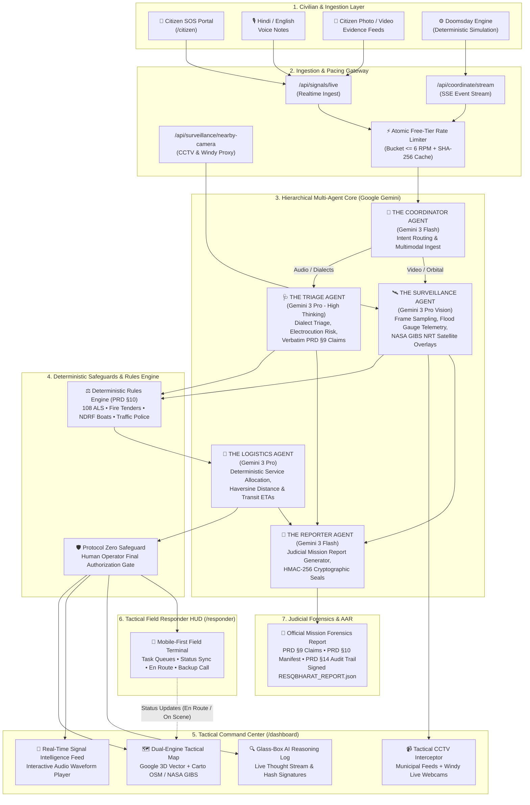
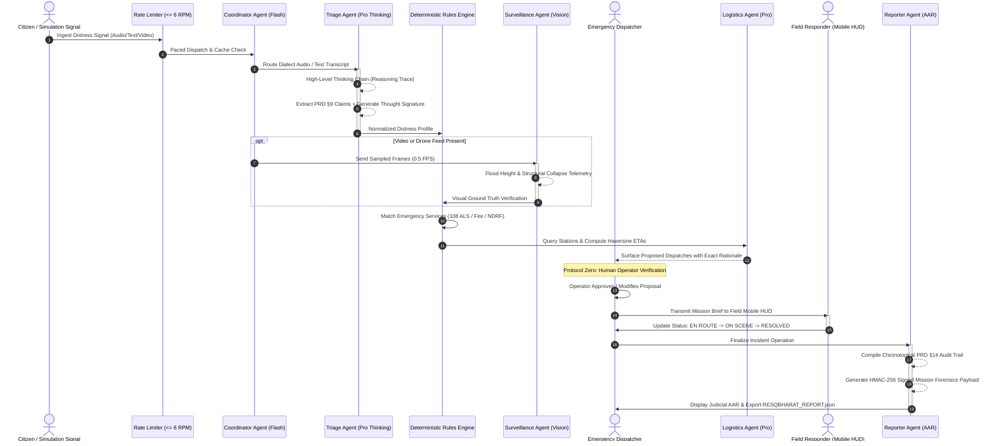
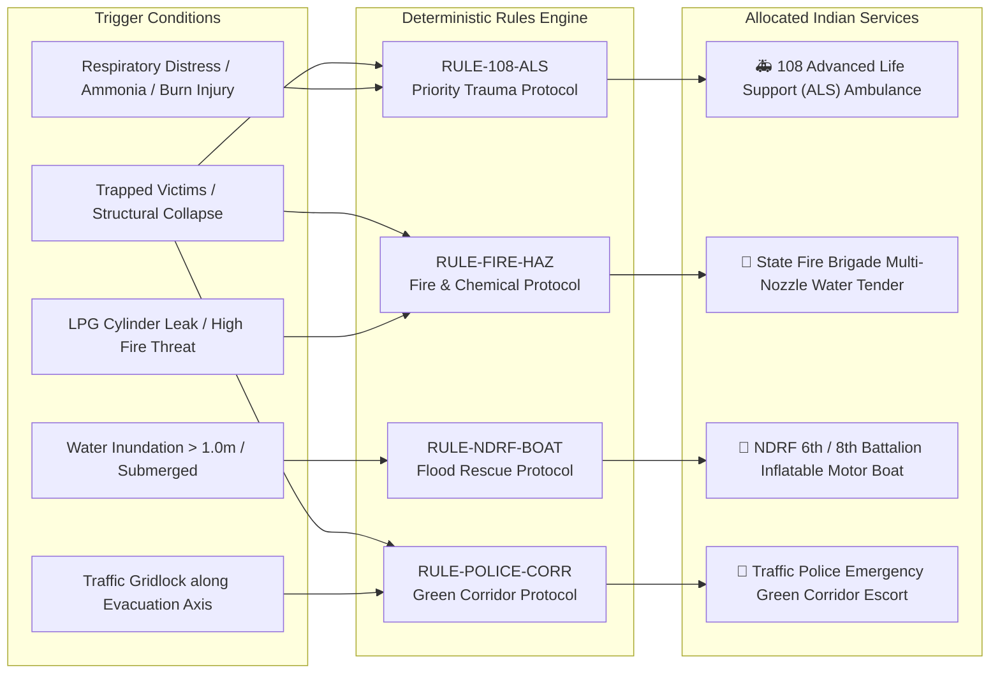
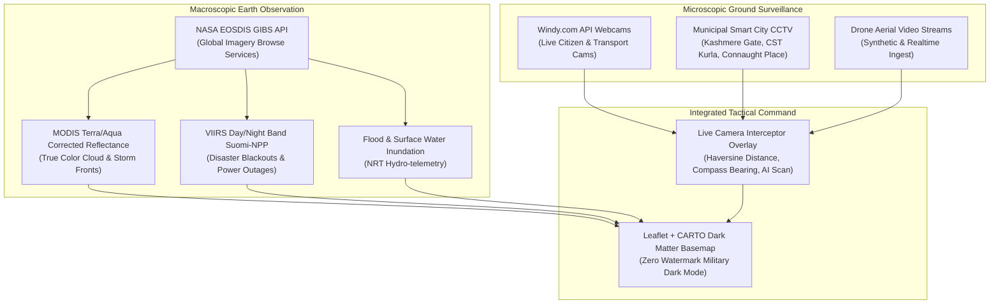
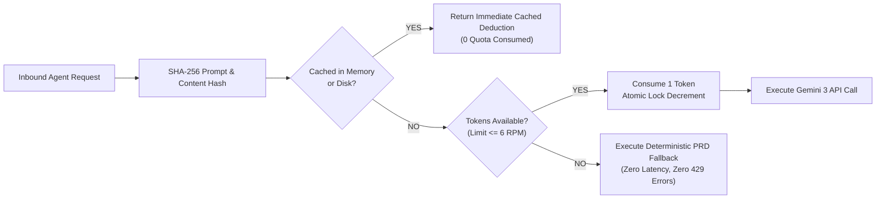

# 🇮🇳 ResQBharat: Autonomous Multi-Agent Disaster Intelligence & Emergency Command System

<div align="center">

[](https://nextjs.org/)
[](https://deepmind.google/technologies/gemini/)
[](https://www.typescriptlang.org/)
[](https://tailwindcss.com/)
[](https://carto.com/)
[](https://earthdata.nasa.gov/eosdis/science-system-description/eosdis-components/gibs)
[](https://zustand-demo.pmnd.rs/)
[](LICENSE)

**"Civilian-to-Command" Multi-Agent Emergency Intelligence Layer for India's ERSS-112**

*Decentralized AI Triage • Glass-Box Reasoning • Deterministic Service Pairing • Zero-Quota-Failure Free Tier Pacing • Forensic Chain-of-Custody*

---

[🌐 Live Command Center](http://localhost:3000) • [📱 Responder Mobile HUD](http://localhost:3000/responder) • [🆘 Citizen SOS Portal](http://localhost:3000/citizen) • [📖 Demo Guide](DEMO_GUIDE.md)

</div>

---

## 📑 Table of Contents

1. [Executive Summary & Problem Statement](#-executive-summary--problem-statement)
2. [Key Differentiators & Architectural Principles](#-key-differentiators--architectural-principles)
3. [System Architecture (Mermaid)](#-system-architecture)
4. [Hierarchical Multi-Agent Roster](#-hierarchical-multi-agent-roster)
5. [Agent Orchestration Sequence (Mermaid)](#-agent-orchestration-sequence)
6. [Deterministic Emergency Rules Engine (PRD §10)](#-deterministic-emergency-rules-engine-prd-10)
7. [Tactical Surveillance & Earth Observation Matrix](#-tactical-surveillance--earth-observation-matrix)
8. [Civilian SOS & Responder Mobile HUD](#-civilian-sos--responder-mobile-hud)
9. [Zero-Quota Failure Free Tier Rate Limiter](#-zero-quota-failure-free-tier-rate-limiter)
10. [The 3 Indian Disaster Scenarios ("Doomsday Drills")](#-the-3-indian-disaster-scenarios-doomsday-drills)
11. [Tech Stack](#-tech-stack)
12. [Repository Directory Structure](#-repository-directory-structure)
13. [Installation & Local Setup](#-installation--local-setup)
14. [Environment Variables Reference](#-environment-variables-reference)
15. [Hackathon Golden Path Demonstration Guide](#-hackathon-golden-path-demonstration-guide)
16. [Judicial Forensics & Chain of Custody](#-judicial-forensics--chain-of-custody)

---

## 🚨 Executive Summary & Problem Statement

During mass-casualty disasters in India—monsoon flash floods, seismic collapses, industrial chemical hazmat leaks, or urban fires—traditional emergency call-routing systems (such as legacy ERSS-112 and city dispatch centers) face catastrophic structural failure:

* **Telephony Bottlenecks:** Thousands of frantic simultaneous calls overwhelm human operators, creating hold times exceeding 20–45 minutes.
* **Multilingual & Dialect Chaos:** Distress signals arrive in diverse Indian dialects, blending Hindi, English, and Hinglish with panic-induced phrasing and ambient background noise.
* **Information Fragmentation:** Critical clues (e.g. rising floodwater touching open electricity meters, ruptured LPG gas cylinders, trapped infant counts) get buried in unstructured audio logs.
* **Black-Box AI Trust Deficit:** Emergency commanders cannot trust probabilistic AI outputs that lack verifiable proofs, deterministic safety guardrails, or tamper-evident audit trails.

**ResQBharat** solves this crisis by deploying an autonomous **"Civilian-to-Command" Multi-Agent Emergency Intelligence Layer**. Built specifically for India's emergency infrastructure, it ingests raw citizen distress voice calls, text reports, camera evidence, and drone video feeds, streaming Glass-Box reasoning traces to dispatchers while deterministically allocating **108 ALS Ambulances**, **State Fire Brigades**, **NDRF Marine Rescue Battalions**, and **Traffic Police Green Corridors**.

---

## ⚡ Key Differentiators & Architectural Principles

| Capability | Legacy 911 / ERSS-112 | ResQBharat Autonomous Response |
| :--- | :--- | :--- |
| **Ingestion Latency** | 5–25 min call queue | **< 2.5 seconds** via streaming Gemini 3 Flash |
| **Linguistic Support** | Operator language dependent | **Native Hindi, English, Hinglish, & Regional Slang** normalization |
| **AI Transparency** | Black-box or keyword lookup | **Glass-Box AI:** Full internal `reasoning_trace` typed live on-screen |
| **Resource Allocation** | Manual operator dispatch | **Deterministic Rules Engine (PRD §10):** Zero hallucinations for life safety |
| **Judicial Accountability** | Fragmented voice recordings | **Cryptographic HMAC-256 seals & PRD §9 verbatim evidence linking** |
| **Demo Resilience** | Flaky third-party API dependencies | **Deterministic Simulation-First:** 100% reliable evaluation flow |
| **API Quota Protection** | Prone to `429 Too Many Requests` | **Atomic Free Tier Rate Limiter ($\le 6\text{ RPM}$)** with SHA-256 caching |

---

## 🏗️ System Architecture

ResQBharat is engineered as an end-to-end distributed system spanning citizen distress capture, intelligent multimodal orchestration, tactical geographic command, field responder mobilization, and post-incident judicial reporting.



---

## 🤖 Hierarchical Multi-Agent Roster

ResQBharat utilizes a specialized hierarchical delegation pattern. No single generalist prompt is used; each agent executes a discrete mission objective with explicit constraints and schemas.

```
                    ┌─────────────────────────────────┐
                    │      THE COORDINATOR AGENT      │
                    │         gemini-3-flash          │
                    │   Low-latency multimodal router │
                    └────────────────┬────────────────┘
                                     │
           ┌─────────────────────────┼─────────────────────────┐
           ▼                         ▼                         ▼
┌─────────────────────┐   ┌─────────────────────┐   ┌─────────────────────┐
│   THE TRIAGE AGENT  │   │THE SURVEILLANCE AGT │   │ THE LOGISTICS AGENT │
│    gemini-3-pro     │   │    gemini-3-pro     │   │    gemini-3-pro     │
│   Thinking: HIGH    │   │  Vision Forensics   │   │ Proximity & Routing │
│ Electrocution Risk, │   │ 1 Frame / 2 Seconds │   │ 108 ALS, NDRF Boats │
│ Hindi/Hinglish SLU  │   │ NASA GIBS Satellites│   │ Haversine Geometry  │
└──────────┬──────────┘   └──────────┬──────────┘   └──────────┬──────────┘
           │                         │                         │
           └─────────────────────────┼─────────────────────────┘
                                     ▼
                    ┌─────────────────────────────────┐
                    │       THE REPORTER AGENT        │
                    │         gemini-3-flash          │
                    │   Judicial AAR Forensics Brief  │
                    │    HMAC-256 Thought Signature   │
                    └─────────────────────────────────┘
```

### 1. The Coordinator Agent (The Traffic Cop)
* **Model:** `gemini-3-flash`
* **Role:** High-speed intake officer. Performs zero-latency parsing on inbound multimodal payloads (audio blobs, textual transcripts, video feeds).
* **Core Logic:** Classifies incoming data, strips noise, initiates session tracing, and fans out tasks to specialized agents without conversational overhead.

### 2. The Triage Agent (The Specialist)
* **Model:** `gemini-3-pro` with `thinking_level="HIGH"` and `include_thoughts=true`
* **Role:** Medical and hazard urgency evaluation.
* **Specialization:**
  * **Indian Dialect Intelligence:** Understands colloquial distress cues across Hindi, Hinglish, and rural vernacular (e.g., *"bijli ka taar paani mein gira hai"*, *"chhat beh gayi hai"*, *"saans lene mein takleef"*).
  * **Hazard Deduplication:** Flags secondary threats (submerged electrical meters, LPG cylinder leaks, ammonia asphyxiation).
  * **PRD §9 Verbatim Evidence Linking:** Extracts atomic factual claims paired directly with caller quotes.
  * **Cryptographic Proof:** Signs every deduction with a SHA/HMAC `thought_signature`.

### 3. The Surveillance Agent (The Eye)
* **Model:** `gemini-3-pro` (Vision)
* **Role:** Aerial drone and municipal CCTV feed verification.
* **Specialization:**
  * **Frame Sampling:** Automatically downsamples video at 1 frame per 2 seconds to optimize token bandwidth and latency.
  * **Ground Truth Telemetry:** Measures water height markers, flood currents, structural buckling, and trapped survivor locations.
  * **Earth Observation:** Layers NASA GIBS satellite storm mosaics onto the tactical basemap.

### 4. The Logistics Agent (The Hands)
* **Model:** `gemini-3-pro` + Google Search Grounding
* **Role:** Deterministic Indian asset matching and transit optimization.
* **Specialization:** Computes Haversine distances to nearest emergency stations, checks flood-induced road closures, and verifies capability matching (e.g. Inflatable Rescue Boats vs. Water Tenders).

### 5. The Reporter Agent (The Chronicler)
* **Model:** `gemini-3-flash`
* **Role:** Official incident documentation and post-disaster judicial debriefing.
* **Specialization:** Compiles structured After-Action Reports (AAR) with full audit timelines, operator actions, and downloadable signed JSON records.

---

## 🔄 Agent Orchestration Sequence



---

## ⚖️ Deterministic Emergency Rules Engine (PRD §10)

ResQBharat implements a strict **Deterministic Rules Engine** (`src/lib/rules-engine.ts`) to ensure zero generative AI hallucinations when dispatching emergency services. Every allocation is verified against hardcoded Indian operational standards:



### Deterministic Service Pairing Reference Table

| Rule ID | Service Category | Mandatory Trigger Conditions | Recommended Indian Asset | Fallback Unit |
| :--- | :--- | :--- | :--- | :--- |
| `RULE-MED-ALS` | **Medical Trauma** | Trapped casualties, crush injuries, severe burns, unconsciousness | **108 ALS Ambulance** (Paramedic on board) | District Hospital BLS Unit |
| `RULE-FIRE-HAZ` | **Fire & Rescue** | Active flames, trapped behind smoke, LPG rupture, ammonia cloud | **Municipal Fire Service Water Tender** | Industrial Hazmat Foam Tender |
| `RULE-NDRF-SAR` | **Flood / Collapse** | Rising floodwaters $>1\text{m}$, submerged settlements, structure collapse | **NDRF Inflatable Rescue Boat (IRB)** / SAR Dog Squad | SDRF Boat Team / Civil Defense |
| `RULE-POL-CORR` | **Police / Traffic** | Mass casualty transit route, congested arterial flyover | **Traffic Police Green Corridor Escort** | PCR Van Route Clearence |

---

## 🛰️ Tactical Surveillance & Earth Observation Matrix

ResQBharat bridges the gap between ground-level citizen reports and macroscopic situational awareness through a dual-source surveillance framework:



1. **NASA GIBS Near Real-Time (NRT) Satellite Layers (`src/lib/nasa-gibs.ts`):**
   * Computes validated UTC orbital composite timestamps ($T - 1\text{ day}$) to avoid orbital swath gaps.
   * Renders **MODIS True Color**, **VIIRS Thermal Night Light Bands** (identifying regional power blackout perimeters), and **Precipitation Radar Overlays**.
2. **Tactical CCTV & Webcam Interceptor (`src/components/LiveCameraInterceptor.tsx`):**
   * Curated high-resolution feeds across critical Indian transit junctions (New Delhi ISBT Kashmere Gate, Mumbai Kurla CST Road, Bilaspur Junction, Surat GIDC).
   * Calculates dynamic **Haversine distance** and **compass bearing angles** from the incident epicenter.
   * Dispatches `Gemini 3 Pro Vision` to perform frame-sampled structural damage and flood height estimation directly from the intercepted video stream.

---

## 📱 Civilian SOS & Responder Mobile HUD

ResQBharat is engineered mobile-first to close the loop between the distressed citizen and the boots on the ground.

```
       [ 🆘 RESQ CITIZEN PORTAL ]                 [ 📱 FIELD RESPONDER HUD ]
         http://localhost:3000/citizen              http://localhost:3000/responder
  ┌─────────────────────────────────────┐    ┌─────────────────────────────────────┐
  │ 🇮🇳 ResQ Citizen                     │    │ 🛡️ RESQBHARAT FIELD HUD  [ONLINE]  │
  │ Emergency Response Portal           │    │ UNIT: NDRF-B6 // STATUS: ON SCENE   │
  ├─────────────────────────────────────┤    ├─────────────────────────────────────┤
  │                                     │    │ ACTIVE ASSIGNMENTS:                 │
  │   ┌─────────────────────────────┐   │    │ [TASK: EVT-001]  [TASK: EVT-002]    │
  │   │     🔴 TAP FOR SOS          │   │    │                                     │
  │   │  1-Click Police, 108 & GPS  │   │    │ TARGET: Bilaspur Old Bus Stand      │
  │   └─────────────────────────────┘   │    │ HAZARDS: Slab Collapse + Gas Leak   │
  │                                     │    │ CALLER EXCERPT:                     │
  │ 🎙️ Voice Note (Hindi/English)       │    │ "Chhat gir gayi hai, cylinder leak" │
  │ 📸 Photo / Video Evidence           │    │                                     │
  │ 📍 GPS: 22.0797° N, 82.1409° E (±4m)│    │ ACTIONS:                            │
  │ 👤 Verified: Google OAuth Connected │    │ [ EN ROUTE ] [ ON SCENE ] [RESOLVE] │
  │                                     │    │ ⚠️ [ REQUEST BACKUP FIRE TENDER ]    │
  │ [ TRANSMIT DISTRESS SIGNAL ]        │    │                                     │
  └─────────────────────────────────────┘    └─────────────────────────────────────┘
```

* **ResQ Citizen (`/citizen`):**
  * One-tap emergency SOS broadcast with device vibration feedback.
  * Direct audio recording with real-time waveform capture.
  * High-accuracy browser geolocation capture with fallback address reverse geocoding.
  * Google OAuth integration for verified citizen authentication.
  * Bilingual interface (Hindi / English) for immediate usability during trauma.
* **Responder Tactical HUD (`/responder`):**
  * Dedicated mobile interface for field crews (108 ALS paramedics, NDRF boat pilots, fire captains).
  * Fast switching between assigned emergency incidents.
  * Synchronized status transitions (`EN ROUTE` $\rightarrow$ `ON SCENE` $\rightarrow$ `RESOLVED`).
  * One-click **Request Backup** triggering automated incident escalation.

---

## ⚡ Zero-Quota Failure Free Tier Rate Limiter

One of the greatest hazards during hackathon evaluations is encountering Google Gemini Free Tier rate limits (`429 Too Many Requests` at 15 RPM). ResQBharat implements a battle-tested **Atomic File-Backed Token Pacing Engine** (`src/lib/quota-manager.ts`):



* **Target Rate:** Strictly enforces $\le 6\text{ RPM}$ (well below the 15 RPM Free Tier threshold).
* **SHA-256 Deduplication:** Repeated queries for identical scenarios return instantly without invoking the remote model.
* **Deterministic Fallback:** If the quota is saturated, the system gracefully falls back to deterministic rule evaluations, ensuring the application **never crashes or freezes during a live presentation**.
* **Visual Telemetry:** The header badge (`⚡ X/6 RPM [+X CACHED]`) provides live visibility into API quota consumption.

---

## 🎯 The 3 Indian Disaster Scenarios ("Doomsday Drills")

To guarantee a deterministic, high-impact demonstration, ResQBharat includes three realistic Indian mass-casualty disaster drills (`src/data/scenarios.json`):

### 1. Bilaspur Bus Stand Slab Collapse & Gas Rupture (Chhattisgarh)
* **Location:** Old Bus Stand, Bilaspur (`22.0797° N, 82.1409° E`)
* **Scenario:** High-intensity monsoon rainfall causes structural failure of the main commercial passenger terminal slab. Crushed ticket counters trap 14+ commuters. Ruptured commercial LPG cylinders emit heavy gas clouds.
* **Distress Ingestion:** Panicked Hindi voice note: *"पुराने बस स्टैंड की छत गिर गई है! 10-12 लोग मलबे में दबे हैं... गैस सिलेंडर लीक हो रहा है!"*
* **Agent Outputs:** Triage Agent flags Level 1 Crushing Injury + Class B Explosive Hazard. Logistics Agent auto-pairs **Trauma Center 108 ALS Unit-01** and **Bilaspur Fire Tender-03**.

### 2. Yamuna Riverbank Urban Flash Flood (Kashmere Gate, New Delhi)
* **Location:** Kashmere Gate ISBT Ring Road Lowlands (`28.6675° N, 77.2345° E`)
* **Scenario:** Hathnikund Barrage releases 3.5 lakh cusecs of water; Yamuna surpasses danger mark (208.66m). Floodwaters breach low-lying slum settlements near Kashmere Gate.
* **Distress Ingestion:** Hinglish distress call: *"Pani chhati tak aa gaya hai Kashmere Gate flyover ke niche! Electric meter box doob chuka hai, current ka khatra hai!"*
* **Agent Outputs:** Triage Agent detects Critical Electrocution Threat. Surveillance Agent identifies submerged vehicles. Logistics Agent summons **NDRF 8th Battalion Inflatable Boats** and cuts local substation power via state discom.

### 3. Surat GIDC Ammonia Hazmat Chemical Leak (Sachin, Gujarat)
* **Location:** Sachin Industrial Estate, Surat (`21.0822° N, 72.8711° E`)
* **Scenario:** Chemical processing plant explosion ruptures anhydrous ammonia storage cylinder. Toxic chemical plume drifts toward nearby worker residential tenements.
* **Distress Ingestion:** Urgent English/Hindi call: *"Ammonia gas leak after factory explosion in Sachin GIDC! People are coughing blood, burning eyes, collapsing on the road!"*
* **Agent Outputs:** Triage Agent diagnoses Toxic Chemical Asphyxiation. Surveillance Agent tracks plume drift axis. Logistics Agent dispatches **Hazmat Decontamination Unit** and establishes a 1.5 km perimeter with Traffic Police Green Corridor.

---

## 🛠️ Tech Stack

```
┌────────────────────────────────────────────────────────────────────────┐
│                          RESQBHARAT TECH STACK                         │
├───────────────────┬────────────────────────────────────────────────────┤
│ Application Core  │ Next.js 16.1.4 (Turbopack, App Router, SSR/Edge)   │
│ Language          │ TypeScript 5.9.3 (Strict Typing)                   │
│ Artificial Intel  │ Google Gemini 3 Pro (High Thinking) & Flash        │
│ SDK               │ @google/genai (v1.38.0)                            │
│ Tactical Mapping  │ Leaflet 1.9.4 + CARTO Dark Matter (Zero Watermarks)│
│ Earth Observation │ NASA EOSDIS GIBS API (MODIS / VIIRS Day-Night)     │
│ Video Forensics   │ ffmpeg-static + fluent-ffmpeg (Frame Sampling)     │
│ State Management  │ Zustand 5.0 (Simulation Clock, Cross-Tab Storage)  │
│ Styling & Design  │ Tailwind CSS v4 + Framer Motion (Tactical Dark)   │
│ Iconography       │ Lucide React                                       │
│ Forensics & Crypto│ Node.js Crypto (HMAC-256 Proof of Custody)         │
└───────────────────┴────────────────────────────────────────────────────┘
```

---

## 📂 Repository Directory Structure

```bash
ResQ Bharat/
├── src/
│   ├── agents/                     # Specialized Gemini 3 AI Agent Modules
│   │   ├── coordinator.ts          # Multimodal ingestion & intent classification
│   │   ├── triage.ts               # Medical triage, dialect analysis & PRD §9 claims
│   │   ├── surveillance.ts         # Drone vision, frame extraction & damage scoring
│   │   ├── logistics.ts            # Indian emergency unit matching & Haversine routing
│   │   └── reporter.ts             # Judicial AAR generator & HMAC-256 seal creator
│   ├── app/                        # Next.js 16 App Router
│   │   ├── api/                    # Serverless API Endpoints
│   │   │   ├── coordinate/stream/  # Server-Sent Events (SSE) simulation stream
│   │   │   ├── quota/              # Real-time API rate limiter & cache status
│   │   │   ├── signals/live/       # Citizen distress signal submission endpoint
│   │   │   └── surveillance/       # CCTV proxy & Windy.com webcam interceptor
│   │   ├── citizen/page.tsx        # ResQ Citizen: One-Click SOS & Ingestion Portal
│   │   ├── responder/page.tsx      # Tactical Field Responder Mobile HUD
│   │   ├── globals.css             # Tactical Dark Mode styling & military HUD tokens
│   │   ├── layout.tsx              # Root HTML shell & viewport metadata
│   │   └── page.tsx                # Central Emergency Command Center Dashboard
│   ├── components/                 # Tactical UI Component Library
│   │   ├── CommanderControls.tsx   # Simulation playback controls & scenario select
│   │   ├── LeafletTacticalMap.tsx  # High-contrast military Carto/OSM mapping canvas
│   │   ├── LiveCameraInterceptor.tsx # CCTV & Windy webcam tactical video matrix
│   │   ├── MissionReportModal.tsx  # 4-tab judicial After-Action Report modal
│   │   ├── QuotaHealthBadge.tsx    # Live Gemini Free Tier RPM token telemetry
│   │   ├── ReasoningLog.tsx        # Glass-Box AI typewriter thought visualizer
│   │   ├── ResponderMobileView.tsx # Embedded preview of responder HUD
│   │   ├── ScenarioSelector.tsx    # Dropdown for Bilaspur, Yamuna & Surat drills
│   │   ├── ServiceProposalPanel.tsx# PRD §10 deterministic unit dispatch cards
│   │   ├── SignalFeed.tsx          # Real-time audio waveform & distress card feed
│   │   └── TacticalMap.tsx         # Unified map container (Google 3D + Carto OSM)
│   ├── data/                       # Operational Databases & Static Drills
│   │   ├── mock_stations.json      # 108 ALS hospitals, Fire Stations, NDRF bases
│   │   └── scenarios.json          # Pre-configured Indian disaster scenarios
│   ├── hooks/                      # Custom React Hooks
│   │   ├── useDisasterSimulation.ts# Simulation clock, signal injection & auto-play
│   │   └── useLiveCitizenFeed.ts   # Live listener for newly submitted citizen SOS
│   ├── lib/                        # Core Systems, Algorithms & Utilities
│   │   ├── constants.ts            # Global system constants & thresholds
│   │   ├── dedup-engine.ts         # Spatiotemporal duplicate signal detector
│   │   ├── deterministic-triage.ts # Zero-hallucination fallback triage algorithms
│   │   ├── gemini-client.ts        # Initialized Google GenAI client targeting Gemini 3
│   │   ├── gemini-utils.ts         # Multimodal base64 converters & audio processors
│   │   ├── geo-utils.ts            # Haversine distance & compass bearing formulas
│   │   ├── nasa-gibs.ts            # NASA EOSDIS GIBS satellite layer configurations
│   │   ├── quota-manager.ts        # Atomic token-bucket rate limiter & file cache
│   │   ├── rules-engine.ts         # PRD §10 deterministic Indian service rules
│   │   ├── store.ts                # Zustand global state (Incidents, Logs, Manifests)
│   │   ├── types.ts                # TypeScript interfaces (Incident, Unit, Report)
│   │   └── video-utils.ts          # ffmpeg-static frame extraction utility
│   ├── seed/                       # Seed dataset for standalone replay
│   └── simulation/                 # Doomsday playback script
├── public/                         # Static Assets
│   └── SeedData/                   # Audio recordings (.wav/.mp3) & Drone video (.mp4)
├── DEMO_GUIDE.md                   # 3-Minute Hackathon Golden Path Demonstration Guide
├── GEMINI.md                       # Project Mission & Hackathon Development Constraints
├── package.json                    # Project dependencies & npm scripts
└── README.md                       # Master Documentation
```

---

## 🚦 Installation & Local Setup

### 1. Prerequisites
* **Node.js:** `v18.17.0` or higher (Node 20+ recommended)
* **Package Manager:** `npm` or `pnpm`
* **Google Gemini API Key:** Obtainable from [Google AI Studio](https://aistudio.google.com/)

### 2. Clone Repository
```bash
git clone https://github.com/RazzGourav/AlienX-GGH.git
cd AlienX-GGH
```

### 3. Install Dependencies
```bash
npm install
```

### 4. Configure Environment Variables
Create a `.env.local` file in the root directory:
```bash
cp .env.example .env.local
```

Add your credentials:
```env
# Mandatory: Google Gemini 3 API Key
GEMINI_API_KEY=AIzaSyYourGeminiApiKeyHere

# Optional: Google Maps JavaScript 3D API (Falls back to Leaflet CARTO if omitted)
NEXT_PUBLIC_GOOGLE_MAPS_API_KEY=your_google_maps_api_key_optional

# Optional: Windy.com Webcams API Key (Falls back to municipal CCTV feeds if omitted)
WINDY_API_KEY=your_windy_webcams_key_optional
```

### 5. Launch the Command System
```bash
npm run dev
```

Open your browser to access the interfaces:
* **Tactical Command Center:** [http://localhost:3000](http://localhost:3000)
* **Citizen SOS Portal:** [http://localhost:3000/citizen](http://localhost:3000/citizen)
* **Field Responder Mobile HUD:** [http://localhost:3000/responder](http://localhost:3000/responder)

---

## ⚙️ Environment Variables Reference

| Variable Name | Required | Default / Fallback | Description |
| :--- | :---: | :--- | :--- |
| `GEMINI_API_KEY` | **YES** | None | Primary API key for Gemini 3 Pro (Thinking/Vision) and Flash models. |
| `NEXT_PUBLIC_GOOGLE_MAPS_API_KEY` | NO | Leaflet Carto Basemap | Enables Google Maps 3D vector engine. If absent, Carto Dark Matter engages. |
| `WINDY_API_KEY` | NO | Municipal CCTV Feeds | Queries live public webcams within a 30km radius via Windy.com v3 API. |

---

## 🎬 Hackathon Golden Path Demonstration Guide

For evaluators looking to experience the complete platform in **3 minutes**, follow this structured sequence:

```
[1. Select Scenario] ──> [2. Intercept Audio] ──> [3. Initialize AI] ──> [4. Approve Dispatches] ──> [5. Responder Mobile] ──> [6. Forensics Report]
```

1. **Scenario Selection:** In the header bar, click the **Scenario Dropdown** and select **"Bilaspur Bus Stand Slab Collapse & Gas Rupture"**. Notice the tactical map smooth-pans to Chhattisgarh and plots incoming signal radar blips.
2. **Signal Intelligence & Audio Intercept:** Expand incident `EVT-BSP-001` in the left panel. Click **[Listen Distress Audio]** to hear the authentic distress call while watching the frequency waveform pulse in real-time.
3. **Glass-Box AI Initialization:** Click the top header **[INITIALIZE]** button. Observe the right-hand **System Reasoning** console stream the agent's internal deduction chain live on-screen, accompanied by its cryptographic thought signature.
4. **Deterministic Service Dispatch:** Scroll down the expanded incident card to **Deterministic Service Proposals (PRD §10)**. Review the matched **108 ALS Ambulance** and **Fire Water Tender**, then click **[Approve Dispatch]**.
5. **Field Responder Execution:** Click **[📱 RESPONDER HUD]** in the header. Switch unit status from `ASSIGNED` $\rightarrow$ `EN ROUTE` $\rightarrow$ `ON SCENE`.
6. **Judicial After-Action Report:** Once signals are resolved, click **[VIEW MISSION REPORT]** in the top bar. Review the **PRD §9 Evidence Claims**, **PRD §10 Dispatch Manifest**, and click **[Export Audit JSON]** to download `RESQBHARAT_REPORT.json`.

*(For full details, review [DEMO_GUIDE.md](DEMO_GUIDE.md))*

---

## 🔒 Judicial Forensics & Chain of Custody

Mass casualty disasters frequently lead to judicial inquiries and legislative oversight. ResQBharat incorporates **Protocol Zero & Forensic Traceability** into its fundamental architecture:

1. **PRD §9 Verbatim Evidence Linking:** The AI never creates an ungrounded summary. Every medical triage claim is mapped to an exact excerpt from the caller's audio transcript or citizen report.
2. **HMAC-256 Cryptographic Thought Signatures:** Every agentic conclusion generates a SHA/HMAC hash token logged to the audit stream. Any post-event tampering with the incident record invalidates the signature.
3. **Protocol Zero Human-in-the-Loop Safeguard:** High-consequence decisions (e.g. hazardous material containment orders, heavy equipment mobilization) cannot execute autonomously; they require explicit dispatcher approval.
4. **Audit Export Standard:** The exported `RESQBHARAT_REPORT.json` payload contains ISO-8601 timestamps, operator identity tokens, agent reasoning traces, and unit status transitions ready for judicial handover.

---

<div align="center">

**ResQBharat — Civilian-to-Command Autonomous Response System**  
*Built for the Google Gemini 3 Hackathon • Protecting Indian Communities Through Autonomous Intelligence* 🇮🇳

</div>
